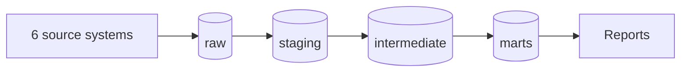

# WebShop Pro analytics platform

> [!WARNING]
> **Work in progress!**
> This is a personal learning and pet project that I build step by step, as my time and
> energy allow. I also have a dog - so this is a pet project in more than one sense, and the
> other pet has priority.
> The build log below shows what is finished and what comes next.

**Build log site:** https://mankadata.github.io/webshop-analytics-platform/

## Business context

WebShop Pro is an online retailer founded in 2025, selling ~230 products in six categories
to seven Central-European countries, in HUF and EUR. Its data lives in six systems: the shop
database, a payment provider, an ERP, ad platforms, web analytics and ECB exchange rates.
Every team used its own spreadsheet, so "orders last month" had three different answers.

This project builds the company's warehouse: one place where metrics are defined once and
reconcile across systems. The marts layer will answer four groups of questions:
- **Management & finance:** net revenue, gross margin, contribution margin, payment reconciliation
- **Marketing:** customer acquisition cost, ROAS, conversion funnel by channel
- **Operations:** stock on hand, stockouts, supplier lead times
- **CRM:** customer segments, retention, repeat purchases

## How it is built

First the raw exports of the six source systems are loaded into a PostgreSQL warehouse and
profiled, because a model can only be designed well once the real data and its defects are
known. The staging layer then gives every raw table clean names and correct types without
dropping anything, so it stays a stable, one-to-one base for everything above it. The
intermediate layer does the real cleaning : deduplication, standardisation, currency
conversion and quarantining of bad rows, because these steps need business rules and
reference data. The marts layer turns the result into dimensions, facts and reports that the
business can trust, with personal data masked. Finally, tests, orchestration and CI make the
whole pipeline run every day and stop bad data before it reaches a report.

## Progress

| Step | Topic | Status |
|---|---|---|
| 1 | Setup: warehouse and dbt project | done |
| 2 | Data sources: raw data and source declarations | done |
| 3 | Data profiling: what the raw data looks like | done |
| 4 | Staging models | in progress |
| 5 | Intermediate: cleaning, keys, deduplication, quarantine | planned |
| 6 | Marts: dimensions, facts, business marts | planned |
| 7 | Data quality and tests | planned |
| 8 | Orchestration and CI | planned |
| 9 | Dashboards and reports | absolutely not! I love dashboards, but this project is big enough without them. Sorry, not sorry. |

## Technologies and why

| Technology | Role | Why |
|---|---|---|
| **PostgreSQL 16** | data warehouse | free, runs anywhere, and supports warehouse-style SQL (window functions, JSON, grants); the SQL moves to Snowflake or BigQuery with few changes |
| **Docker Compose** | runs the database (and later Airflow) | the same environment on every machine and in CI, nothing installed by hand |
| **dbt Core** | transformations, tests, documentation | the industry standard for analytics engineering: SQL models, dependency graph, built-in tests and lineage |
| **Python** | source simulator and raw loader | the usual language for ingestion; reads CSV, JSON and Hungarian-encoded files |
| **Apache Airflow** | daily orchestration | the most widely used scheduler; runs each layer in order and stops on failed tests |
| **GitHub Actions** | CI and publishing | runs checks on every change and publishes the build log site |
| **GitHub Codespaces + VS Code** | development environment | everything runs in the cloud - no installs or disk space on my own computer |
| **Git + GitHub Pages** | version control and project site | every step is a reviewed commit, and the build log is public |

## Acknowledgements

## Acknowledgements

- **Data:** all data is synthetic. It is generated by a deterministic Python simulator
  (`ingestion/`), so there are no real customers or transactions. The simulator plays the
  role of the data engineering team.
- **AI assistance:** I use an AI assistant (Claude by Anthropic). It helps me draft
  documentation, for example the data profiling write-up, code comments and commit
  messages. I decide the scope, and I build, run, test and review every step myself.
  Where I needed help, I asked the AI.

## License

© 2026 mankadata. All rights reserved.

You are welcome to read this code. Please do not copy, redistribute or reuse substantial parts of it without permission. The code is provided
"as is", without warranty of any kind, and I accept no liability for its use.
