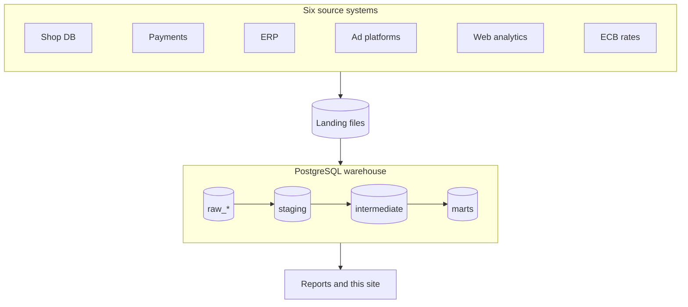

# Overview

## The company

WebShop Pro is an online retailer founded in 2025, selling ~230 products in six categories
to seven Central-European countries, in HUF and EUR. Its data lives in six systems: the shop
database, a payment provider, an ERP, ad platforms, web analytics and ECB exchange rates.
Every team used its own spreadsheet, so "orders last month" had three different answers.

## The goal

Build the company's data warehouse: one place where every metric is defined once, tested,
and reconciles across systems. The marts layer answers four groups of questions:

| Team | Questions |
|---|---|
| Management & finance | net revenue, margin, monthly P&L, do shop, payments and invoices agree? |
| Marketing | customer acquisition cost, return on ad spend, conversion funnel by channel |
| Operations | stock on hand, stockouts, supplier lead times |
| CRM | customer segments, retention, repeat purchases |

## Architecture

Data flows from top to bottom. Data engineering lands the source exports in the `raw_*`
schemas; **this project's focus is everything after that** - the dbt layers that turn raw
data into trusted business tables.

## Layers

dbt naming is used, with the medallion (lakehouse) equivalent in brackets:

| Layer | Schema | Responsibility | Materialization |
|---|---|---|---|
| Raw | `raw_<source>` | files loaded as-is, every column text, with lineage columns | tables, loaded by Python |
| Staging (bronze) | `staging` | one model per source table: rename, cast, flatten JSON - nothing dropped | view |
| Intermediate (silver) | `intermediate` | clean, deduplicate, join, convert currencies, apply business rules | view (table where needed) |
| Marts (gold) | `marts` | dimensions, facts and reports for the business | table |

## Tech stack

PostgreSQL 16 in Docker · dbt Core 1.12 · Python 3 · Apache Airflow · GitHub Actions ·
GitHub Codespaces with VS Code

## Build log

Each tab of this site documents one step: the goal, what was built, the decisions behind it
and how it was verified.

| Step | Topic | Status |
|---|---|---|
| 1 | Setup: warehouse and dbt project | done |
| 2 | Data sources: raw data and source declarations | in progress |
| 3 | Staging models | planned |
| 4 | Intermediate: cleaning, keys, deduplication, quarantine | planned |
| 5 | Marts: dimensions, facts, business marts | planned |
| 6 | Data quality and tests | planned |
| 7 | Orchestration and CI | planned |