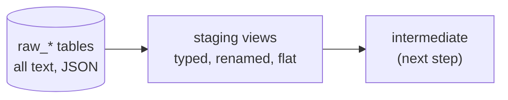

# Step 4 - Staging

## Goal

One clean, typed view for every raw table, so that no later model ever reads `raw_*`
directly. Staging only makes **lossless** changes: rename, cast, flatten. Nothing is
filtered, deduplicated or "fixed" here - every raw row is still visible, so the
intermediate layer can decide what to do with it.

## What was built

14 models in `dbt/webshop_analytics/models/staging/`, one folder per source system,
materialized as views in the `staging` schema:

| Source | Models |
|---|---|
| shop | `stg_shop__customers`, `stg_shop__products`, `stg_shop__orders`, `stg_shop__order_items`, `stg_shop__returns` |
| payments | `stg_payments__events` |
| erp | `stg_erp__suppliers`, `stg_erp__purchase_orders`, `stg_erp__purchase_order_lines`, `stg_erp__stock_movements`, `stg_erp__invoices` |
| marketing | `stg_marketing__ad_campaigns` |
| web | `stg_web__events` |
| ecb | `stg_ecb__fx_rates` |



## Conventions

| Rule | Example |
|---|---|
| File name `stg_<source>__<entity>` | `stg_erp__invoices` |
| CTE pattern `source` -> `renamed` (or `flattened`, `unnested`) | every model reads like the same template |
| English column names | Hungarian ERP headers -> `supplier_code`, `invoice_date_raw` |
| Explicit casts | `cast(order_id as integer)`, `cast(shipping_fee as numeric(12, 2))` |
| `_raw` suffix = still dirty, fixed later | `email_raw`, `country_raw`, `net_amount_raw` |
| `_local` suffix = local time or original currency | `ordered_at_local`, `unit_price_local` |
| `_minor` suffix = amount in minor units (cents) | `amount_minor` |
| Lineage columns kept | `_batch_id`, `_loaded_at` |

## Typical model

```sql
with source as (
    select * from {{ source('shop', 'orders') }}
),

renamed as (
    select
        cast(order_id as integer)               as order_id,
        cast(customer_id as integer)            as customer_id,
        cast(ordered_at as timestamp)           as ordered_at_local,
        nullif(lower(trim(status)), '')         as status,
        upper(trim(currency))                   as currency,
        cast(shipping_fee as numeric(12, 2))    as shipping_fee_local,
        _batch_id,
        _loaded_at
    from source
)

select * from renamed
```

## Decisions

- **Nothing is filtered.** Unlike many tutorials, test payments, duplicates and impossible
  order lines stay in staging. Dropping them is a business decision, made - and documented -
  in intermediate.
- **Messy values are kept, not guessed.** Hungarian numbers (`298 818`, `42,97`), dates
  (`2025.01.01.`) and free-text countries stay as text with a `_raw` suffix. Parsing them
  needs rules, so it belongs in intermediate.
- **Schema drift is absorbed here.** The shop renamed `phone` to `phone_number` on
  2026-03-01; `coalesce(phone_number, phone) as phone_raw` gives one column for all history.
- **JSON is flattened here.** Payment webhooks are read with `->>` and `#>>`, and epoch
  seconds become `timestamptz` with `to_timestamp()` - a lossless, mechanical change.
- **Arrays are unnested here.** One ad report holds many campaign rows;
  `cross join lateral jsonb_array_elements(payload -> 'rows')` gives one row per campaign
  per day. This is the only model with more rows than its raw table - by design.

## How it was verified

```bash
cd dbt/webshop_analytics
dbt run --select staging        # 14 views created, PASS=14
```

Row counts were compared with the raw tables: every staging view has exactly as many rows
as its source, except the ad campaigns model, which unnests the report arrays.