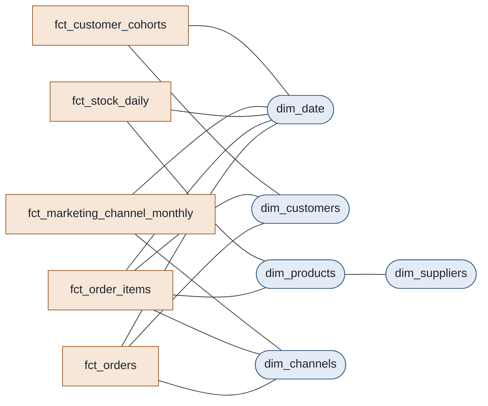

# Step 7 - Marts

## Goal

Business-ready tables for the four teams, built as physical tables in the `marts` schema.
Every metric is defined once, so finance, marketing, operations and CRM get the same answer.

## The galaxy schema

Facts (orange) in the middle of the business, shared dimensions (blue) around them.

### Enterprise bus matrix

| Fact (business process) | date | customers | products | suppliers | channels | Team |
|---|:---:|:---:|:---:|:---:|:---:|---|
| `fct_orders` - sales | ✅ | ✅ | | | ✅ | finance, CRM |
| `fct_order_items` - sales by product | ✅ | ✅ | ✅ | | ✅ | finance, operations |
| `fct_stock_daily` - inventory | ✅ | | ✅ | ✅ | | operations |
| `fct_marketing_channel_monthly` - marketing | ✅ | | | | ✅ | marketing |
| `fct_monthly_revenue` - monthly revenue | ✅ | | | | ✅ | finance |
| `fct_customer_cohorts`, `dim_customer_segments` - retention | ✅ | ✅ | | | | CRM |

> **Why one set of dimensions and not one star per team?** If marketing and finance had their
> own customer table, the same customer could look different in their reports - and the
> company would be back to "three answers to one question". Shared (*conformed*) dimensions
> live in the `core` folder; team folders only aggregate on top of them (Kimball's bus architecture).

> **Why is orders a fact and customers a dimension?** A fact is something that *happened*:
> an event with numbers you can add up (revenue, cost, units), many rows, never changed later.
> A dimension is the *context* - who, what, when, from whom - with attributes you filter and
> group by. Quick test: "Can I sum it?" -> fact. "Do I filter by it?" -> dimension.

> **Grain first.** Every mart states its grain in its first line - "one row per order",
> "one row per product and day". Mixing grains in one table is the most common cause of
> double-counted revenue.

## Definitions that matter

| Term | Count | Definition |
|---|---:|---|
| registered person | 5,106 | one person may have several accounts (same e-mail) |
| person with an order | 4,405 | placed at least one order, paid or not |
| buyer | 4,385 | at least one paid and invoiced order |
| net revenue | | ERP invoice net amount (without VAT) minus credit notes, in EUR at the order-day rate |

## What the marts say

| Team | Finding |
|---|---|
| Finance | Net revenue 2.10 M EUR in 2025 and 2.17 M EUR in 2026 (to 8 Nov). Gross margin a stable ~23 %. Electronics brings half of the sales at the lowest margin (21.8 %), books the highest (31.1 %). |
| Marketing | Paid search: ROAS 7.4, CAC 135 EUR. Paid social: ROAS 4.7, CAC 229 EUR - the most expensive new customer. E-mail costs 9 EUR per new customer. |
| Operations | Stockout on 0.7 % of product-days. 94 products were negative at some point - sales are booked before the goods receipt. |
| CRM | 75 % of buyers come back and bring 93 % of revenue. Champions are 12 % of customers and 38 % of revenue; 734 customers (769 k EUR) are at risk. Retention is ~20 % after 1, 3 and 6 months. |

## A data error that almost became a business decision

The first margin check showed **27.4 % in 2025 falling to 23.2 % in 2026**. The cause was not
the business: 23 products sold from the opening stock had no purchase order, so their cost was 0.
Taking the cost from the stock movements instead, the margin is **23.5 % and 23.2 %** - stable.
A test now guards it (step 8).

> **Privacy by design.** `dim_customers` holds no names, e-mails or phone numbers. Personal
> data stays in the intermediate layer; the marts carry only what analysis needs.
